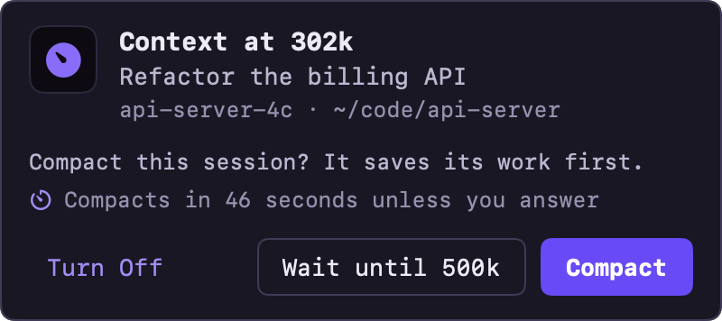
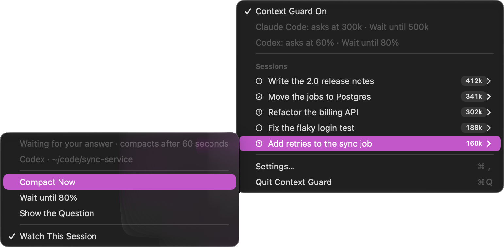
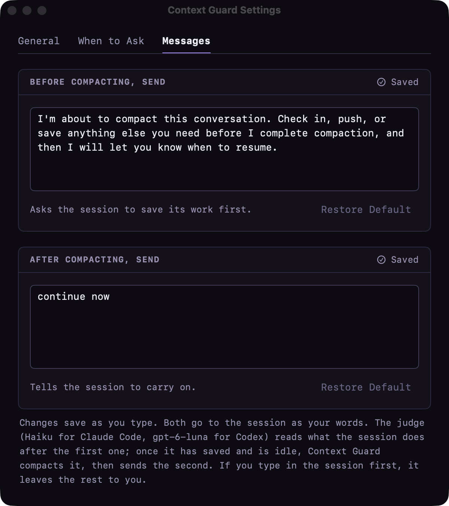

# Context Guard



A small Mac menu bar app for [Claude Code](https://code.claude.com/docs/en/overview) and the
[Codex CLI](https://github.com/openai/codex). When a session's context gets big, it asks before
compacting. If you say yes, the session saves its work first, then it's compacted and told to carry
on.

There are about a thousand ways to handle context in Claude Code: `/compact` by hand, auto-compact,
and plenty of other tools. This is just the one I like. The story behind it is on the blog:
**[Context Guard: ask before compacting](https://spaceterran.com/posts/context-guard-claude-code/)**.

## What it does

When a session reaches **300k** tokens of context, a popup asks whether to compact it. Compacting
starts by asking the session to save its work, with this message (you can change it):

> I'm about to compact this conversation. Check in, push, or save anything else you need before I
> complete compaction, and then I will let you know when to resume.

- **Compact** sends that message now. A working session gets it at its next step. An idle one is
  woken with it.
- **No answer in 60 seconds** counts as Compact. The popup counts down.
- **Wait until 500k** does nothing now. The session is asked to save, then compacted, when it
  reaches 500k.
- **Turn Off** stops all asking and compacting by itself until you turn it back on from the gauge in
  the menu bar.

Once the session has the message (from these, or **Compact Now** in its menu), Context Guard
finishes the job:

1. Every 10 seconds while no turn is running, Haiku reads what the session did after the message and
   decides whether it has finished saving. A question to you, or a session still waiting on a push
   or CI, holds it; so does a session that ignored the message.
2. Once it's ready, the session is compacted, as `/compact` does it. Text in the prompt box holds it.
3. When the compaction is done and no turn is running, **continue now** goes in as your words. If
   you typed or sent something first, it's left to you.

Agents, commands and monitors the session left running in the background don't hold any of this.
They keep running through the compaction, and what they bring back reaches the compacted session,
which carries on from what it saved. A session that can't be ready until one of them finishes says
so, and Haiku holds it until it's done.

A notice says when it needs you, when it compacts and how it went. After a session compacts, it's
asked again the next time it reaches 300k.

Haiku needs no sign-in or key: the mod asks it through the Claude Code session it runs in, with that
session's account.

Each session's menu has **Watch This Session**. Turned off, that tab gets no questions and isn't
compacted by itself until it closes or you turn it back on. **Compact Now** always works, even there
and with Context Guard off.

Settings has three tabs: **General** (on or off, open at login, what's installed), **When to Ask**
(the thresholds, and how long a question waits before it compacts by itself; 0 for never) and
**Messages** (the save message and the continue message). Changes save as you type. The When to Ask
and Messages cards say in their header when your last change was saved, or that it wasn't and why.

| The session's menu | Settings |
|---|---|
|  |  |

It doesn't care which terminal you use (tested in Warp, Terminal and Ghostty): everything goes
through Claude Code's own hooks and plugins.

**Codex** sessions get the same, with two differences: the thresholds are a share of each session's
context window (60% and 80%), and a small OpenAI model reads whether the session has saved, in place
of Haiku. See [Codex](#codex).

## Requirements

- macOS 14 or newer.
- Xcode Command Line Tools 16.4 or newer (Swift 6.1 or newer): `xcode-select --install`.
- `jq`: built into macOS 15 and later; on macOS 14, `brew install jq`.
- Claude Code with plugin support (tested with 2.1.318), signed in as usual.
- For Codex sessions: the Codex CLI (tested with 0.167.1), signed in as usual. Without it, nothing
  changes.

## Install, update, uninstall

```
git clone https://github.com/SpaceTerran/context-guard.git
cd context-guard
./install.sh                 # install, or update after a git pull
./install.sh --no-codex      # the same, without the Codex link (removes one installed before)
./install.sh --uninstall     # remove the hooks, the hook program, the mod, the Codex link and the app
```

It builds on your Mac (about a minute), so there's nothing to download and nothing for Gatekeeper to
block. `install.sh` does the following:

- builds everything (`build.sh`);
- puts the hook program at `~/.claude/hooks/context-guard/context-guard`;
- adds the hooks to `~/.claude/settings.json`, after backing it up next to itself. Other hooks are
  left alone, and running it again doesn't add the hooks twice;
- copies the mod to `~/.claude/hooks/context-guard/mod` and installs it as the user plugin
  `context-guard@context-guard`. Claude Code reads it from that folder, so an update is a copy;
- adds a LaunchAgent, `~/Library/LaunchAgents/com.spaceterran.ContextGuard.codex.plist`, that keeps
  `context-guard codex` running for Codex sessions (see [Codex](#codex)). macOS says "Background
  Items Added";
- installs `~/Applications/Context Guard.app`, sets it to open at login, and starts it.

Running sessions pick up the hooks within a few seconds, and the mod at `/reload-plugins` or their
next start. Uninstalling keeps your settings and session records in `~/.claude/context-guard`.

## How it works

Claude Code has no way for another app to type into a session, so the message goes in through
Claude Code's own hooks:

| Hook | What it does |
|---|---|
| `PostToolBatch` | Runs after each step (about 7 ms). It reads the new part of the transcript for the context size, asks at 300k, and adds a waiting save message to the session's next step. |
| `Stop` (`asyncRewake`) | Stays in the background after every turn, until the next turn replaces it (up to 12 hours). When you click Compact or Compact Now, or the session reaches 500k, it exits 2, which wakes the session with the save message once no turn is running. |
| `SessionStart`, `SessionEnd`, `StopFailure` | Note compactions, `/clear`, exits and failed turns. |

Nothing outside a session can run `/compact` in it, so compacting after the save message is done by a
**mod** (`mod/`): a Claude Code plugin whose code runs inside each interactive terminal session. It
holds no rules. Every 10 seconds it runs `context-guard mod tick` with the session's id, its running
subagents and whether the prompt box has text. The program reads the transcript and answers with one
step: ask Haiku (with the prompt to send), compact, send the continue message, or nothing. The mod
does it and reports back with `context-guard mod report`. It also runs `context-guard mod turn` as
each turn of the conversation starts and ends.

- **Delivery:** a save message goes out exactly once, by whichever path comes first. It counts as sent
  only once it shows up in the transcript.
- **Mid-turn:** a session is never woken in the middle of a turn. A wake there would land inside a
  tool result, where the model treats it as a prompt injection. Between turns a wake starts a new
  turn, even with agents or commands running in the background. Claude Code's session list says
  `busy` both mid-turn and while background agents run, so the mod's turn records tell the two apart.
  Without them (an older mod, or none), `busy` counts as mid-turn.
- **Which sessions:** only interactive terminal sessions are guarded. Subagents, `claude -p` and SDK
  runs are left alone.

| File | Written by |
|---|---|
| `~/.claude/context-guard/config.json` | the app and `context-guard on/off`: on/off, thresholds, messages, the wait before a question compacts by itself |
| `~/.claude/context-guard/sessions/<id>.json` | the hook, `context-guard mod` and `context-guard codex`: each session's size, where its save message stands, and how compacting is going |
| `~/.claude/context-guard/answers/<id>.json` | the app and `context-guard answer`: your answer to a popup |
| `~/.claude/context-guard/muted/<pid>-<start>.json` | the app and `context-guard watch`: a tab you stopped watching, by its Claude process |
| `~/.claude/context-guard/turns/<id>.json` | `context-guard mod turn`: whether the session's latest turn is running, and since when |

The hook program also works from a terminal. `install.sh` doesn't put it on your PATH, so give it a
short name first:

```
alias context-guard=~/.claude/hooks/context-guard/context-guard
context-guard status                  # every session and where it stands
context-guard answer <id> yes|later|skip
context-guard watch <id> on|off       # watch a session's tab, or stop
context-guard on | off
context-guard codex [--only-cwd <folder>] [--verbose]
                                      # the Codex link (the LaunchAgent runs it)
```

## Codex

Codex hooks can't start a turn or a compaction, so Codex sessions are reached another way. A plain
`codex` in any terminal runs its session in Codex's shared background server, and
`context-guard codex` (kept running by the LaunchAgent) connects to that server's socket,
`~/.codex/app-server-control/app-server-control.sock`, the same way the terminal does. There's no
Codex hook or plugin to install. The link:

- reads each session's size from its file in `~/.codex/sessions`;
- puts the save and continue messages in the session's queue, so the terminal shows them as prompts
  from you. The save message ends with a tag like `[cg-1a2b3c4d5e]`, which marks it as Context
  Guard's;
- compacts the session, as `/compact` does;
- asks the judge whether the session has finished saving.

It connects only while a Codex terminal has run in the last 5 minutes, and never starts or stops
Codex's server.

**The judge.** Haiku isn't available to Codex, so the judge is OpenAI's smallest model,
**gpt-6-luna** (or gpt-5.6-luna, else the session's own model), at low effort. It runs as a
throwaway Codex session with your Codex sign-in: no API key, no tools, no MCP servers, and nothing
saved to your history. Each check takes a few seconds and about 4k tokens of your Codex usage. It
follows the same rules as Haiku: a question to you, or a session still waiting on a push or CI,
holds it.

**Thresholds.** Codex models have different context windows (258k on most today), so the
thresholds are a share of each session's window: it asks at **60%** and, told to wait, compacts at
**80%**. Settings → When to Ask has a Codex card for both. Codex compacts by itself at about 95% of
the window, and that would cut a save short, so Wait goes no higher than 84%, and stays a tenth of
the window below Codex's own point if you've lowered it (`model_auto_compact_token_limit`). The
popup shows both numbers: "Context at 62% (160k)".

What's different from Claude Code:

- **Nothing goes in mid-turn.** The save message and the compaction wait for the turn to end. A very
  long turn can reach Codex's own compaction first; a notice says so.
- **The prompt box can't be read** from outside Codex, so text you've typed but not sent doesn't
  hold the compaction.
- **A terminal has to show the session.** Messages go out only to a session a terminal has open.
  Which ones are open is worked out from the `codex` processes running in terminals: their folder,
  or the session `codex resume <id>` names. A `codex resume` from another folder, without an id,
  isn't seen; its messages wait and `status` says "no terminal shows it".
- **Watch This Session** belongs to the Codex session, not the tab. `/new` starts a new session,
  which is watched again.
- **Which sessions:** only terminal sessions in the shared server. A `codex` started with `-c`,
  `--profile`, `--no-daemon` or `--oss` runs its session inside the terminal's own process, where
  nothing else can reach it. `codex exec`, the Codex app and subagents are left alone.
- **An older Codex** missing something the link needs is only watched. Settings and `status` say
  why.

| File (in `~/.claude/context-guard/`) | Written by |
|---|---|
| `codex-link.json` | `context-guard codex`, every 5 seconds: running or stopped, connected, Codex's version, the judge model |
| `codex-link.log` | `context-guard codex`: what it did. At 1 MB it moves to `codex-link.log.1` and starts again |
| `codex-link.stderr` | launchd: anything the link printed as an error |
| `muted/codex-<id>.json` | the app and `context-guard watch`: a Codex session you stopped watching |

## Development

```
swift test                                     # the rules, transcript reading, hook runs, the Codex link
claude plugin test mod                         # the mod, against a mocked clock and program
live-test/ui-demo.sh start dark                # the app on staged sessions (four Claude Code, one Codex)
live-test/ui-demo.sh snap <folder> <name>      # the app draws its windows to PNGs (works with the
                                               # screen locked)
live-test/session.sh start <name> 60 75        # a real Haiku session with low thresholds
CG_TEST_PLUGIN_DIR=$PWD/mod CG_TEST_AUTO_YES=5 live-test/session.sh start <name> 60 75
                                               # the same, with the mod and a 5 s countdown
CG_TEST_TERMINAL=terminal CG_TEST_PROMPT="Read filler-1.txt" live-test/session.sh start <name> 60 75
                                               # the same in a Terminal.app window (or ghostty)
```

The live tests keep their files in `.scratch/` at the repo root. They never touch your real
sessions or settings. Without `CG_TEST_TERMINAL`, `session.sh` runs Claude Code in a hidden terminal
that needs [`uv`](https://docs.astral.sh/uv/).

## License

MIT. See [LICENSE](LICENSE).
